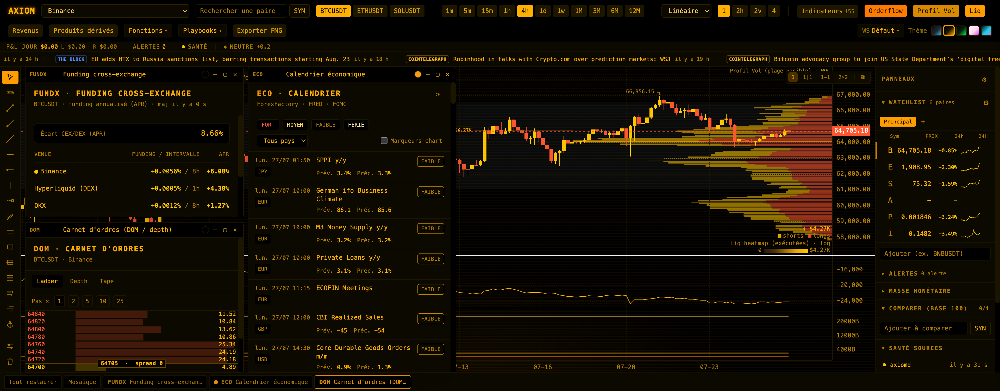

# AXIOM Terminal

Terminal de charting, orderflow et contexte macro **mono-utilisateur** (un opérateur, ses propres clés API). Crypto d’abord (spot + perp) ; tradfi / commodités en complément.

Décisions figées : voir **`BUILD-CONTRACT.md`** (renderer-first, KLineChart, indicateurs TS pur, daemon localhost hors chemin chaud, pas de multi-tenant / Electron / AggregationEngine).



## Présentation

AXIOM est un **poste de marché local**, dans l’esprit d’un terminal Bloomberg ramené à un seul
opérateur : une command line (`⌘K`), des **mnémoniques** courtes (`ECO`, `DOM`, `FUNDX`, `SCEN`…),
des fenêtres flottantes avec snap et taskbar, des workspaces commutables — le tout servi par un
process local unique et **vos** clés API.

**Pour qui.** Un opérateur qui veut lire le marché crypto (spot + perp) *et* son contexte macro
depuis un seul écran, avec des sources publiques et ses accès personnels optionnels. Ce n’est
pas un SaaS : pas de multi-tenant ni d’auth réseau. Les appels aux fournisseurs utilisent les
droits de l’opérateur ; certains historiques exigent une clé ou un abonnement.

| | |
|---|---|
| **Lire le prix** | orderflow / CVD / footprint, profil de volume, heatmap de liquidations (exécutées, estimées, niveaux réels Hyperliquid), **221 indicateurs** testés |
| **Lire le contexte** | **39 fenêtres** à mnémonique : calendrier éco, news, corrélations, on-chain, mouvements de baleines, treemap, options, COT (synthèse + graphique hebdomadaire de l'exposition de chaque catégorie de traders), taux (dont 24 familles macro sur 8 zones) & liquidité Fed, saisonnalité, stablecoins, cycle halving… |
| **Décider** | screener, playbooks 1-clic, alertes (dont composite ET), backtest en R (stop ATR / sizing risque), coût d’exécution L2 (DOM), stress-test, étude d’évènements, journal, paper trading |
| **Ne pas décrocher** | alertes onglet fermé (macOS + Telegram optionnel), replay sur dumps officiels Binance, panneau de santé des sources |

**Sources automatiques** : choisissez un actif dans la recherche commune ; AXIOM
sélectionne une source disponible et indique sa provenance. Pour un même
instrument au comptant, la source retenue est celle qui offre le plus
d'historique à l'unité de temps affichée (HYPEUSDT : Bybit plutôt que Binance) ;
la recherche affiche « Auto » le temps de la mesure. En cas d'échec de
l'historique, il essaie une autre source compatible, sans changer la devise ni
remplacer un marché comptant par un perpétuel. Les contrats Hyperliquid apparaissent
explicitement sous la forme `BTC-PERP`. Les deux jambes des ratios sont également
résolues automatiquement ; les accès nécessitant une clé restent personnels.
Voir le [rapport de revue](docs/revue-2026-09-23-sources-automatiques.md) et celui
sur la [profondeur d'historique](docs/revue-2026-09-26-profondeur-historique.md).

Deux partis pris structurent le produit :

1. **Le chemin chaud reste direct.** Le front parle **directement** aux WebSockets des exchanges ;
   le daemon `axiomd` ne prend en charge que le lent (APIs à quota, cache, persistance SQLite,
   alertes). L’UI reste utilisable **sans** daemon.
2. **Les calculs sont du TypeScript pur et testés.** Les 221 indicateurs vivent dans
   `@axiom/indicators` — pas de WASM, pas de service Python — et sont couverts par des tests
   unitaires et structurels, dont **4 indicateurs comparés à un oracle `pandas-ta`** (ADX,
   SuperTrend, Ichimoku, PSAR ; `scripts/golden/`), des oracles analytiques ATR/RSI/Bollinger/RVOL
   et des vérifications de causalité par préfixe.

**Hors périmètre assumé** : pas d’exécution d’ordres réels (aucune clé de trading). Le paper
trading (`PAPER`) est une simulation locale déjà présente ; pas de multi-utilisateur, pas
d’Electron.

## Architecture

```
packages/
  types/         @axiom/types       — contrat de données partagé
  indicators/    @axiom/indicators  — 221 indicateurs TS pur + golden tests
  alerts/        @axiom/alerts      — moteur d’alertes pur (front + daemon)
  backtest/      @axiom/backtest    — moteur de backtest pur
apps/
  web/           @axiom/web         — front Vite + React + KLineChart
  daemon/        @axiom/daemon      — axiomd (Bun + SQLite, 127.0.0.1:8787)
shared/
  extapi-hosts.ts                   — whitelist unique du proxy /extapi
docs/
  research/      notes fournisseurs, edge, roadmap
  superpowers/   specs & plans d’implémentation
```

**Invariant** : le front parle en **direct** aux WebSockets des exchanges. Le daemon ne proxifie / cache / persiste **que** les APIs lentes à quota et les services annexes (alertes, globe, replay…). L’UI reste utilisable **sans** daemon (feature-detect `/health` + repli localStorage).

## Prérequis

- **Node.js** 22 (référence CI) et **pnpm** 9 (`packageManager` piné dans `package.json`)
- **Bun 1.3.11** (version épinglée pour le daemon et ses tests) : https://bun.sh
- Clés API optionnelles dans `apps/web/.env` (voir `apps/web/.env.example`)

## Installation

```bash
pnpm install
cp apps/web/.env.example apps/web/.env   # puis renseigner les clés utiles
```

## Démarrage

One-shot (recommandé) — cold-start en une commande :

```bash
pnpm run up       # daemon + Vite dev → http://localhost:5173
pnpm run up:prod  # build front + daemon → http://127.0.0.1:8787
```

> ⚠️ `run` obligatoire : `pnpm up` **nu** résout vers le builtin pnpm `update`
> (alias réservé `up`) — il ne lance pas le stack et peut muter le lockfile.

`pnpm run up` vérifie `pnpm`/`bun`, lance `pnpm install` si besoin, démarre le daemon
(log `logs/daemon.log`), attend `/health` (15 s), puis le front. Ctrl+C arrête
les process lancés par le script.

## Commandes

| Commande | Effet |
|---|---|
| `pnpm run up` | One-shot dev (daemon + Vite) |
| `pnpm run up:prod` | One-shot prod (build + daemon sert le dist) |
| `pnpm dev` | Front Vite seul (dev, proxys CORS intégrés) |
| `pnpm daemon` | Daemon localhost `127.0.0.1:8787` |
| `pnpm prod` | Build front + sert le dist via le daemon |
| `pnpm test` | Tests de tous les packages / apps |
| `pnpm typecheck` | `tsc --noEmit` sur le monorepo |
| `pnpm build` | Build récursif |
| `pnpm check` | Contrôle qualité local (typecheck + test + build web) |
| `pnpm check:e2e` | Parcours navigateur hermétiques utilisés en CI (Chromium Playwright requis) |

Fallback dual-terminal (si besoin de séparer les logs) :

```bash
pnpm daemon       # http://127.0.0.1:8787  (optionnel en dev)
pnpm dev          # http://localhost:5173
```

Prod locale (équivalent manuel de `pnpm run up:prod`) :

```bash
pnpm prod
# ouvrir http://127.0.0.1:8787
# (Chrome mode app : open -a "Google Chrome" --args --app=http://127.0.0.1:8787)
```

## Déploiement Vercel

Le build Vercel sert le front et un proxy serverless restreint aux hôtes de
`shared/extapi-hosts.ts`. Aucun secret partagé n'est injecté dans ce proxy public : les **dix
clés** saisissables dans **Réglages** (Coinalyze, Twelve Data, FRED, BGeometrics, SoSoValue,
Finnhub, Etherscan v2, CoinDesk Data/CCData, CoinGecko et DefiLlama Pro) restent dans le `localStorage` du
navigateur. OI et funding du graphe disposent d'un repli Binance sans
clé ; NVT utilise directement les charts publics Blockchain.com.

Le catalogue compte 221 indicateurs. Une entrée impossible pour la source, le symbole ou
le timeframe courant est désactivée et marquée **UNUSABLE** au lieu de produire un pane vide.
Les fonctions intrinsèquement locales sont également nommées : REPLAY et WHALES sont
**UNUSABLE** sur Vercel ; l'historique LIQ et les couches GDELT/UCDP de GLOBE sont **PARTIAL**.
Les snapshots, LIQHL, les alertes baleines et les notifications onglet fermé nécessitent toujours
`axiomd`.

## Fonctionnalités (aperçu)

- **Chart** : multi-grille (1 / 2h / 2v / 2×2), orderflow / CVD / footprint, volume profile (intrabar Binance), fibo, dessins, 221 indicateurs, calcul sur une unité supérieure (EMA 1d sur un graphe 1h)
- **Terminal** : palette ⌘K, raccourcis, workspaces, fenêtres flottantes + snap + taskbar
- **Sources** : Binance, Bybit, OKX, Coinbase, Kraken, MEXC, Deribit, Twelve Data, Coinalyze, FRED, Wikimedia (pages vues Wikipédia), etc.
- **Panneaux** : 39 fenêtres — DES, FUNDX, LIQ, ECO, NEWS, CORR, CHAIN, MAP, PORT, NOTE, EQS, TERM, OMON, DOM, BT, REPLAY, RATE, COT, SEAG, VOL, FUND, BRIEF, GLOBE, STBL, SQZ, CBPREM, NETLIQ, DATA, DIST, EXPY, PAPER, MINE, WHALES, CYCLE, BPL, EVTS, SCEN, CAP, SECT
- **Daemon** : proxy+cache, KV/candles SQLite, alertes (macOS + Telegram optionnel), replay dumps Binance, couches GDELT/UCDP, collecte des mouvements baleines (BTC + stables)

[Bilan des ajouts, sources et vérifications du 7 septembre](docs/revue-2026-09-07.md).

### AXIS — confluence de signaux

**Stratégies → ＋ AXIS** (toute unité de temps) marque sur le prix les
**achats** (▲) et les **ventes** (▼). À la clôture, six votes (EMA 20/50,
Supertrend, DMI filtré par l'ADX, MACD, RSI contre 50 et CMF) forment un score
de −6 à +6 : achat à score ≥ +5 avec clôture au-dessus de l'EMA 200, vente à
score ≤ −4 — lecture long/plat, sans vente à découvert. La bougie en formation
n'est jamais lue ; le survol détaille le score, chaque vote et la performance
depuis l'achat. Lecture indicative absente de BT, **testée le 7 octobre 2026
sur données jamais vues** (BTC/ETH/XRP/SOL, 4h, 2017-2024, protocole figé avant
calcul) : verdict FAVORABLE, mais pas mieux qu'une EMA 200 seule en PnL total
sur 3 actifs sur 4 — mesure passée, jamais une promesse. La **couche
flux** (volume relatif, delta taker Binance, variation d'intérêt ouvert sur les
perps USDT) qualifie chaque signal (« Achat fort » quand les lectures
disponibles confirment, « à contre-sens » quand le delta s'y oppose) et repère
d'un triangle d'accent les **forts achats et fortes ventes** (volume ≥ 3 × la
moyenne, sens du delta taker ou du corps ; étiquette « Fort achat ×n » sur les
trois derniers) ; un réglage optionnel n'achète que sur flux fort. Les
lectures absentes sont dites « n.d. » ; rien ne déplace les signaux par défaut.
**Test du 8 octobre 2026 sur données jamais vues** (BNB/ADA/LINK/DOGE, 4h,
2017-2026, protocole figé avant téléchargement, exécution unique) : les forts
achats sont suivis de +1,61 % en moyenne sur les 12 bougies suivantes
(p ≤ 0,0005, 3 actifs sur 4), mais avec 51 % de hausses seulement — l'avantage
tient aux grandes amplitudes ; les fortes ventes n'ont aucune suite mesurable,
et un signal « fort » ne gagne pas plus qu'un signal ordinaire.
**Test du 8 octobre 2026 sur les treize autres unités** (1s à 1w, 42 alts
jamais vues, protocole figé avant téléchargement, exécution unique) : aucune
ne passe. Les signaux perdent après frais de 1s à 30m et en 3d, sont à peu
près nuls en 1h et, de 2h à 1d, gagnent sans timing démontré face à la même
exposition placée au hasard (p 0,055 à 0,12) ; le 1w n'a que 2 trades clos,
sur environ un an de décisions après l'amorce. Les forts achats n'ont de
continuation démontrée dans aucune de ces unités. Le 4h reste la seule unité
validée. Chaque infobulle dit, pour l'unité affichée, ce qui est mesuré et
ce qui ne l'est pas ; mesure passée, jamais une promesse. Un **stop suiveur
optionnel** (réglage `stopAtr`, × ATR 14, défaut 0 = sans) trace son niveau
sur le prix et étiquette « Stop » les sorties qu'il déclenche.
**Test du 8 octobre 2026 sur données jamais vues** (151 alts, 4h, 2023-2026,
protocole figé avant téléchargement, exécution unique) : le stop 3 × ATR 14
réduit le drawdown sur 82,8 % des actifs mais n'améliore le rendement ajusté
du risque que sur 41,1 % — verdict **DÉFAVORABLE**. Le défaut reste donc sans
stop ; le réglage reste disponible et l'infobulle d'un stop actif dit cet
échec, chiffres à l'appui.
**Fidélité d'affichage (9 octobre 2026)** : les tests lisent des séries
longues, le chart calculait sur 500 bougies — sur les huit grandes cryptos
déjà vues, 60 % des fenêtres de 500 bougies montraient au moins un signal
absent ou en trop (un signal affiché sur neuf), aucun écart à 1 500. Le chart
remonte désormais à **1 500 bougies** de lui-même quand AXIS est actif, et
l'infobulle dit « amorce courte » tant que l'historique n'y arrive pas
(source plus courte, alertes). Le daemon évalue ses alertes 1 min sur la
même profondeur.
**Test du 9 octobre 2026 sur données jamais vues** (123 paires USDT cotées
entre juillet 2023 et juin 2025, 4h, suivies jusqu'en octobre 2026,
protocole figé avant téléchargement, exécution unique) : un **filtre ADX
optionnel** à l'entrée (réglage `adxEntree`, achat seulement si ADX 14 ≥ k,
défaut 0 = sans) a été testé à k = 25 — le seul candidat de l'exploration sur
données vues, qui n'avait pourtant pas passé la règle pré-écrite (écart
déclaré dans le protocole). Il refuse 54 % des entrées de la v2, garde 82 %
de ses trades et améliore le rendement ajusté du risque sur 62,6 % des
actifs, mais **perd à lui seul** sur ce pool (−1,8 % par trade après frais,
−3,7 % par actif contre −4,9 % sans filtre) et l'avantage disparaît en
seconde moitié (48,8 %) — verdict **DÉFAVORABLE**. Le défaut reste donc sans
filtre ; le réglage reste disponible et l'infobulle d'un filtre actif dit cet
échec, chiffres à l'appui. Ces 123 paires sont consommées.
**Garde-fou de régime BTC (10 octobre 2026)** : un réglage `regimeBtc`
(défaut désormais 100) n'autorise l'achat que lorsque la référence du chart
(BTC par défaut) clôture au-dessus de sa propre EMA 100 — référence absente
→ signaux de la v2, infobulle explicite. **Test unique sur données jamais
vues** (139 paires USDT spot KuCoin cotées 2019-2024, 4h, suivies jusqu'en
octobre 2026, protocole figé avant téléchargement, exécution unique) :
verdict **FAVORABLE** — Sharpe meilleur que sans garde-fou sur 75 % des
actifs, drawdown médian 18,3 % contre 21,9 %, expectancy nette +4,6 %
contre +3,3 % par trade après frais (x1 et x3) — le gain vient de ne pas
acheter d'alts quand BTC est sous sa tendance, sur un pool où
l'achat-conservation perd 96 % en médiane : mesure passée, pas une promesse,
et les cellules partagent le même facteur de marché. Le garde-fou s'applique
aussi dans la fenêtre BT et les alertes web (référence chargée à la volée) ;
sans elle — daemon, screener, rejeu — les signaux restent ceux de la v2.
**Alertes et backtest (9 octobre 2026)** : AXIS expose deux sorties calculées
mais jamais tracées — **État** (1 acheté, 0 à plat) et **Score** (−6 à +6) —
sélectionnables dans une alerte de seuil d'indicateur (achat : État ≥ 1,
vente : État ≤ 0, sans bougie de retard quand la source dit la dernière
clôturée) et dans la fenêtre **BT** (opérandes du catalogue, preset livré
« AXIS confluence (4h) », fills à l'open suivant avec frais et slippage ;
stop, objectif et risque restent à régler).
**AXIS S/R — variante avec futures zones de support/résistance (19 octobre 2026)** :
dans **Stratégies → ＋ AXIS S/R** (`stratAxisSr`), la stratégie est dupliquée
à côté d'**＋ AXIS** (qui reste sans zones S/R) : elle détecte de façon
strictement causale les pivots de swing confirmés (`pivotSr`, défaut 5 bougies
gauche/droite), les regroupe en zones d'épaisseur `± zoneSrAtr × ATR 14`
(défaut 0,5) pondérées par le nombre de touches et de rejets sur volume fort
avec inversion de polarité S↔R après cassure franche, projette sur le graphique
les `maxZonesSr` (défaut 4) futures zones de support (`--up`) et de résistance
(`--down`) les plus proches jusqu'au bord droit, expose les sorties masquées
**Support actif proche** et **Résistance active proche** (ainsi que le preset
BT « AXIS S/R confluence (4h) »), et propose un filtre d'entrée optionnel
`margeResistanceAtr` (défaut 0 = sans) pour éviter les achats immédiatement
sous une résistance active. (Depuis le 9 novembre 2026 : toutes les zones
fortes sont tracées, et `maxZonesSr` ne compte plus que les zones faibles ;
voir ci-dessous.)
**Zones par force et signal précoce (9 novembre 2026)** : AXIS S/R classe
désormais ses zones par force (touches + rejets sur volume fort, forte dès 6
par défaut) — toutes les zones fortes en bande pleine, étiquetées au bord
droit (« S fort · 5 », « R forte · 12 »), les zones faibles les plus proches
(quatre par défaut) en pointillé, les 12 zones fortes cassées les plus
récentes estompées. Un triangle creux marque la bougie close qui entre dans
une zone forte et clôture du bon côté (au-dessus d'un support, au-dessous
d'une résistance), sans attendre le signal confirmé : signal précoce
**non mesuré**, lecture indicative, jamais une promesse (sorties
`reactionSupport` et `reactionResistance` pour une alerte de seuil). Comme une
zone compte ses touches depuis la première bougie chargée, le graphe remonte à
**3 000 bougies** quand AXIS S/R est actif (AXIS seul garde une amorce de
1 500 bougies), et la série de référence du garde-fou de régime est chargée
sur 3 000 bougies, pour AXIS comme pour AXIS S/R.
**Lisible, honnête et annonciateur (11 novembre 2026)** : au téléphone,
l'infobulle du graphe commence sous le bandeau du symbole, et l'essentiel de
chaque ligne tient dans les 55 caractères qu'affiche un écran de 390 px en
thème par défaut (moins sur un écran plus étroit ou en thème Matrix ou
Bloomberg) — une zone s'ouvre par
« AXIS support fort · 5 touches · bord à -1.3 % », un signal confirmé par son
statut de mesure (« test 4h ≈ EMA 200 seule », « 1h : test échoué »). Au bord
droit, une seconde ligne donne l'écart du cours au support fort et à la
résistance forte les plus proches. Les retournements ↺ sont gris, marqués
« ↺ », notés sur 100 et dits **non mesurés** (« heuristique » de poids 1 dans
EQS). AXIS S/R trace un **pré-signal**, non mesuré lui aussi, quand il ne
manque à l'achat que la clôture au-dessus de l'EMA de tendance : un court
pointillé gris à ce niveau, que l'infobulle donne en tête de ligne (« AXIS
pré-signal non mesuré > 64024.02 — … »). Aucun signal confirmé, aucune série
ne change.
Le module qui évalue les alertes est désormais chargé juste après le premier
affichage ; s'il manque, ou si son chargement dépasse dix secondes, le bandeau
écrit « ALERTES inactives » ; en cas d'échec, un avis propose de recharger.
**Au téléphone : texte complet sous le doigt et alertes visibles (12 novembre
2026)** : toucher une zone, un triangle creux ou un signal ouvre, dans
l'encart des prix, le **texte complet** de ce qui est sous le doigt, renvoyé à
la ligne sur fond opaque ; l'encart reste une fois le doigt levé, tant que le
graphe garde son réticule (il part quand le graphe change de marché ou
recharge ses bougies). Sans toucher, chaque rangée du graphe s'arrête à un mot entier suivi de « … »
(plus de nombre coupé), pour tous les indicateurs ; au bureau, les rangées
commencent sous le bandeau du symbole. Une alerte qui se déclenche pousse un
**avis qui reste à l'écran jusqu'au toucher**, « BTCUSDT 4h — AXIS test 4h ≈
EMA 200 seule · signal d'achat », avec « Voir » ; son libellé dit ce qui est
mesuré (« AXIS S/R non mesuré · réaction sur support fort ») au lieu de la
formule brute, dans la liste, le journal et les relais du daemon. Le
formulaire propose AXIS S/R et AXIS en tête, sous des noms (« Signal
d'achat », « Signal de vente », « Non mesuré · réaction sur support fort »),
sans comparateur ni valeur à saisir. Une alerte AXIS n'est plus évaluée tant
que le graphe n'a pas chargé l'historique que l'indicateur demande (1 500
bougies, 3 000 pour AXIS S/R) : la liste écrit alors « historique
insuffisant » (« historique en chargement » depuis le lot 4, plus bas),
ou « hors graphe » quand le graphe principal n'affiche pas son
actif et son unité, ou « condition déjà vraie : sonnera quand elle le
redeviendra » pour une alerte posée alors que sa condition est déjà vraie. Au
retour dans l'application, un signal d'achat ou de vente encore vrai sonne en
datant sa bougie (« · bougie close le 21/10 à 16:00 »), et « Voir » la marque.
**Rien ne sonne Safari fermé ou téléphone verrouillé**, et l'application
déployée ne voit jamais le daemon : une alerte posée sur l'iPhone n'atteint
pas Telegram.
**Alerte de prix au bord d'une zone forte (12 novembre 2026)** : au
téléphone, le doigt sur la bande d'une zone forte d'AXIS S/R, l'encart écrit
sous le texte de la zone un bouton, « Alerte de prix ↓ 76,601.83 · bord du
support fort · niveau fixe, 7 jours ». Un toucher pose une **alerte de prix
ordinaire, à niveau fixe**, au bord de la zone tourné vers le cours, qui
expire dans 7 jours ; l'avis de pose porte « Annuler ». Au bureau, la même
entrée s'ajoute au menu du clic droit. Ce n'est pas un signal : le niveau ne
suit pas la zone, et chaque bord déplacé propose une alerte de plus. Son
message, « ≤ 76,601.83 · bord du support fort AXIS S/R 4h du 01/11 · niveau
fixe », est ce qu'écrivent la liste, le journal et l'avis au déclenchement.
Pas de bouton en paysage, ni quand l'encart ne tient pas dans la place libre
du graphe, ni sur une série synthétique ; une zone hors de l'écran ne se
touche pas. Sur l'iPhone, elle ne sonne qu'application ouverte.
**Backtest avec l'amorce des indicateurs (12 novembre 2026)** : quand une
règle lit un indicateur (ou avec un stop ATR), la fenêtre **BT** charge
avant la plage des bougies strictement antérieures — 1 500 pour AXIS, 3 000
pour AXIS S/R, au moins 300 sinon — et ne mesure que la plage. Sur BTCUSDT 4h
(fixture des tests), « AXIS confluence (4h) » sur 3 mois liste 4 trades au
lieu de 2, chacun entré à l'ouverture qui suit un ▲ du graphe. La note du
run le dit : « 539 bougies mesurées · BTCUSDT 4h · Binance spot · amorce 1500
bougies · … », ou « amorce courte (811 bougies sur 1500) : premiers signaux
pouvant différer de ceux d'une série longue » quand l'historique manque.
Les résultats de tous les presets qui lisent un indicateur bougent en début
de plage ; une règle de prix seule ne change pas. Simulation sur des données
passées : une mesure, pas une promesse.
**Alertes AXIS sans l'indicateur affiché, réglages du graphe et pré-signal
(12 novembre 2026)** : le graphe principal charge de lui-même l'historique
que demandent les alertes actives de son marché (3 000 bougies pour AXIS
S/R, 1 500 pour AXIS), indicateur affiché ou non ; la liste écrit
« historique en chargement : 500 sur 3000 » pendant la remontée. Quand la
place n'a pas assez d'historique, l'alerte est évaluée sur ce qu'il y a et
le dit : « amorce courte : 2988 sur 3000 » sous son état, « · amorce courte
(2989 bougies) » dans l'avis ; un chargement échoué est dit aussi et retenté
une minute plus tard. Une alerte d'AXIS ou d'AXIS S/R copie à sa création
les réglages de l'instance du graphe (« Réglages de l'instance du graphe,
copiés à la création : l'alerte ne suit pas leurs changements. ») et porte
la pastille « ≠ graphe » s'ils changent ensuite. Le formulaire propose
« Non mesuré · pré-signal d'achat » (sortie `preAchat` d'AXIS S/R, libellé
« AXIS S/R non mesuré · pré-signal d'achat (niveau sur le graphe) ») : un
signal précoce non mesuré, jamais une promesse. Rien ne sonne Safari fermé
ou téléphone verrouillé.
[Méthode, réglages, limites et backtests](docs/axis-2026-10-07.md).

### COT — exposition des catégories de traders

**COT → Graphique** trace, pour un marché de la watchlist (devises, indices, or,
argent, WTI, BTC/ETH CME), le net (longs − shorts) de chaque catégorie du rapport
CFTC sur tout l'historique publié : Dealers, Gérants d'actifs / institutionnels,
Fonds à effet de levier, Autres déclarants et Non déclarants pour les financiers
(TFF) ; Producteurs, Swap dealers, Managed Money, Autres et Non déclarants pour
les matières premières (Disaggregated) ; ou le rapport Legacy. Unité en contrats
ou en % de l'open interest, périodes 1 a → Tout, zoom/déplacement, open interest
en panneau séparé. Le tableau sous le graphe donne les chiffres du dernier
rapport et sert de légende. Le bouton « Graphique › » de chaque marché de la
synthèse y mène directement.

Chaque semaine, la CFTC publie le vendredi à 15 h 30 (New York) les positions du
mardi : l'historique est conservé en cache jusqu'à la publication suivante, puis
relu automatiquement (toutes les 15 min pendant 3 h si le rapport tarde, puis
toutes les 6 h — jour férié). Les colonnes CFTC sont lues dans la réponse réelle
avant d'être demandées ; une catégorie introuvable est dite absente et un
contrôle vérifie que la somme des nets de toutes les catégories vaut 0 à chaque
rapport (alerte au-dessus du graphe sinon).

### Outils d'analyse et sources (7 novembre 2026)

Neuf ajouts tirés de l'[étude du 6 novembre](docs/outils-analyse-sources-2026-11-06.md), tous
**descriptifs** : lecture sur bougies closes, aucune valeur inventée, couverture affichée.

- **Graphe** : un indicateur peut être calculé sur une **unité supérieure** (« Unité de
  calcul » dans l'éditeur de paramètres : RSI 4h ou EMA 1d sur un graphe 1h, légende
  « [4h] », badge « partiel » si l'historique supérieur ne couvre pas le début du graphe).
  Le **VPVR**, la **VPFR** et le footprint historique se reconstruisent en **intrabar**
  Binance spot (« réparti à la minute (1m) · N/M », « ≈ réparti sur la bougie » ailleurs).
  La règle Maj donne l'écart en ATR et en σ.
- **EQS** : conditions au modèle du backtest (« + règle »), champs de flux (RVOL, taker
  net, pente du CVD) et de force relative (RS Mansfield 52 sem., RS z), une unité par
  condition, fenêtre « dans les K dernières bougies » ; les symboles non mesurés sont
  comptés, pas confondus avec un échec du filtre.
- **DIST › Bandes RV** : amplitude prévue du jour et de la semaine pour tout actif (HAR-RV,
  quantiles calibrés hors échantillon) ; indicateur **Prime de vol** (DVOL, VRP ex ante,
  percentile ; BTC et ETH).
- **BRIEF** : historique de la largeur du marché (% > MM50/MM200, plus hauts − bas, A/D,
  McClellan, saison des alts) et ligne de régime transversal ; **CAP** : BTC.D hors
  stablecoins.
- **CORR** : onglets **Rotation** (RS-Ratio / RS-Momentum contre BTC, « pas le RRG® ») et
  **Régime** (dispersion, corrélations, ratio d'absorption), univers Top 50.
- **OMON** : surface à **maturité constante** (ATM, RR, BF à 7/30/90 j, historique quotidien)
  et **ΔOI par strike** contre J-1 / J-7.
- **CYCLE** : attention du grand public (pages vues Wikipédia, z-score, épisodes de pic) ;
  **CBPREM** : z et bandes ±2σ désormais causaux (fenêtre glissante de 7 jours).

Limites et points à confirmer : section « Outils d'analyse et sources (autorisation du
7 novembre 2026) » de `BUILD-CONTRACT.md`.

### Historique des décisions et nouveaux indicateurs

Dans **BT**, « Versions et historique » enregistre la configuration complète d'un essai,
archive les statistiques de chaque run réussi et compare deux résultats. Une version
restaure les paramètres sans lancer de calcul. Les archives contiennent une synthèse :
elles ne reconstituent pas les bougies, la courbe d'équité ou toutes les exécutions.
Les écarts chiffrés ne sont comparés que pour le même marché, la même source, le même
intervalle et les mêmes bornes de données.

Le **journal des alertes** permet de créer un dossier de décision dans **EXPY** : preuve
disponible au signal, thèse, invalidation et revue après le trade. « Préparer dans PAPER »
ouvre un brouillon à valider ; la source et les références du dossier suivent ensuite la
position jusqu'à sa clôture. Les anciens signaux restent explicitement partiels.
Les erreurs de sauvegarde de NOTE et EXPY sont visibles et peuvent être réessayées en
conservant la saisie en mémoire.

Quatre indicateurs complètent le catalogue : **liquidations / OI**, **corrélation baissière**,
**bêta baissier** et **dispersion du funding**. La corrélation et le bêta se mesurent sur les
baisses de la référence, avec des prix exactement appariés. Dans **FUNDX → Historique**, les
périodes demandées de 7, 30 ou 90 jours affichent la couverture réellement disponible et
les trous. La dispersion utilise toujours Binance, Bybit, OKX et Hyperliquid : une place
manquante rend le point incomplet, elle ne réduit pas artificiellement la dispersion.

Dans le menu **Indicateurs**, l'étoile enregistre un favori. **Favoris**, **Récents** et
**Utilisables ici** se combinent avec la recherche ; les 12 derniers indicateurs ajoutés
restent accessibles après rechargement. Les motifs d'indisponibilité restent visibles
lorsque le filtre de disponibilité est désactivé.

Les alertes et scans proposent une **durée** à la création et une **prolongation de 24 h**.
Une alerte expirée reste consultable et libère ses flux exclusifs ; la mettre en pause
puis la reprendre ne renouvelle pas sa date. Dans **DATA**, chaque source propose les
actions qu'elle prend en charge et affiche leur résultat.

[Détail des quatre lots et de leurs vérifications](docs/revue-2026-09-23-quatre-lots.md).

### Analyse multidomaine

Les fenêtres existantes proposent huit lectures complémentaires :

| Accès | Fonction |
|---|---|
| **MACRO / RATE** | Quadrants croissance/inflation au dernier mois complet commun, transitions et contexte PIB distinct. |
| **DOM** | Coût d’exécution courant, médiane et P95 sur 1/5/15 minutes pour un montant dans la devise de cotation ; durée et couverture visibles. |
| **CHAIN** | Rotation historique Ethereum/Solana/Base/Arbitrum : parts, variations 30/90 jours, persistance et comparaison au token lorsqu’il existe. |
| **GLOBE** | Scénario de transmission d’un événement sourcé vers un canal économique et les instruments reconnus de la watchlist. |
| **BRIEF** | Synthèse datée, référence enregistrée, changements et divergences descriptives, export de l’instantané affiché. |
| **SCEN** | Sensibilités multifactorielles estimées ensemble, qualité du modèle et chocs hypothétiques de prix ou de taux réel. |
| **FUNDX** | Carry net spot/perp Binance BTC/ETH : profondeur d’entrée, quatre frais, funding et hypothèses de sortie. |
| **EXPY** | Résultats des trades par contexte figé au signal, effectifs et exclusions ; les anciens dossiers restent sans contexte prouvé. |

Ces lectures montrent leurs sources, périodes et limites. Les observations
révisables, scénarios conditionnels et résultats descriptifs ne constituent pas
une stratégie validée. Aucun ordre réel n’est envoyé.

[Méthodes, limites et vérifications](docs/revue-2026-09-23-analyse-multidomaine.md).

### Fonction MACRO et nouveaux indicateurs

`⌘K → MACRO` ouvre **RATE → Indicateurs**. Choisir une famille, les zones et un
historique de **1, 5 ou 10 ans**. Huit zones : États-Unis, zone euro, Royaume-Uni,
Japon, Chine, Inde, Canada et Suisse. `MONEY` conserve l'ancien panneau monétaire.

Les vingt-quatre familles couvrent CPI annuel/mensuel, inflation sous-jacente, PPI, PIB
réel annuel, chômage, production industrielle, change effectif réel, monnaie large,
taux réel US, breakeven, NFCI, spread HY, inscriptions chômage et SOFR−IORB, ainsi que
PCE sous-jacent (niveau, annuel, trois/six mois annualisés), emploi non agricole
(variation mensuelle, moyenne trois mois) et ventes au détail nominales (niveau, mensuel, annuel).
Le catalogue contient 88 définitions, dont 86 raccordées ; deux absences restent explicites.
Les sources, périodes, unités, estimations et retards apparaissent par série.
Les historiques ont la profondeur réellement publiée ; une sélection de dix ans
ne crée pas dix ans de données. Les périmètres nationaux restent distincts
(IPCH/IPC, M2/M3/M4, enquêtes de chômage). ECO ouvre les séries équivalentes et
BRIEF reprend la sélection, ses périodes et ses réserves.

- **GLOBE** : historiques GPR, TPU, GSCPI et trafic PortWatch par détroit, moyenne
  sur sept jours et comparaison saisonnière. Sources officielles et millésimes visibles.
- **CHAIN** : cohortes STH/LTH, capitalisation réalisée et variations 30/90 jours,
  offre BTC en profit/perte, réserves et netflows des exchanges, historique ETF
  5/20 séances et files de staking ETH. Les accès BGeometrics/SoSoValue dépendent
  des droits de la clé ; les groupes partagent les données avec la vue commune des flux.
- **Graphique / DOM** : RVOL saisonnier H1, parts de variance baissière/haussière,
  OFI, microprix et reconstitution du carnet après retrait de liquidité. Cette dernière
  mesure reste une heuristique L2 : annulations et exécutions ne sont pas distinguées.
- **Sauvegardes** : snapshots étendus aux notes, dessins, alertes, journal,
  portefeuille et espaces de travail ; restauration du périmètre exact. Les clés API
  sont exclues des snapshots et de l’export JSON. Importer une ancienne sauvegarde
  ne remplace pas les clés déjà configurées localement. Le daemon reste nécessaire
  pour les sauvegardes durables.

Les deux indicateurs OHLCV sont utilisables dans les alertes et le backtest ; le
RVOL exige H1 et suffisamment de références antérieures. Les mesures L2 et les
historiques macro/on-chain de ces panneaux ne deviennent pas des signaux de
backtest. Les 30 stratégies du catalogue restent **non validées**. Les séries
révisables courantes ne simulent pas ce qui était connu à une ancienne date de publication ;
la vue ALFRED décrite ci-dessous utilise explicitement un millésime.

### Lectures et vérifications du 9 septembre

| Ouvrir | Utilisation et limites |
|---|---|
| **DATA / BRIEF / CHAIN** | Consulter source effective, date d’observation, récupération, couverture et droits. Un cache ancien conserve sa date, le badge vieillit même sans nouvelle collecte et une donnée absente ne vaut pas zéro. Les heures affichées sont en UTC. |
| **MACRO / EVTS** | Choisir une date « connue au » pour FRED/ALFRED et comparer première publication et révision. ALFRED fournit un jour, sans heure intrajournalière. |
| **BRIEF** | Concordance multi-échelle (15 m / 1 h / 4 h / 1 j du symbole du chart) : tendance vs EMA 50, RSI 14, ATR 14 %, Δ 20 barres et compteur d'alignement. Lecture descriptive — un alignement n'est pas un signal ; une échelle en échec reste « — ». |
| **NETLIQ** | Lire TGA Treasury DTS et les contributions Fed/RRP/TGA avec leurs dates ; la comparaison hebdomadaire utilise une période commune. |
| **CHAIN / BRIEF / STBL** | Comparer flux ETF, stock stablecoin et capital réalisé. Les ratios ETF utilisent l’encours de leur séance ; les percentiles exigent une profondeur suffisante. Les alertes de flux conservent leur observation et leur source dans le journal, avec le front actif même si les panneaux sont fermés. |
| **CHAIN / STBL / SECT** | Comparer Ethereum, Solana, Base et Arbitrum : TVL, DEX, stablecoins USD, frais et revenus, dates et variations 30/90/365 jours. Les séries monétaires ne représentent pas des quantités corrigées de l’effet de prix. |
| **ECO → EVTS** | Ouvrir une annonce comparable, importer des archives sourcées, consulter consensus daté et surprise, puis réaction BTC/ETH avant/après 5/15/60 minutes et 24 heures. L’heure est explicite en UTC ; une fenêtre OHLC trouée reste partielle. [Schéma d’import](docs/guides/archives-publications.md). |
| **DOM / EQS** | Diagnostic du symbole maître Binance : prix/CVD spot 5 min et OI perp en quantité, période commune, seuils et persistance réglables. Les coûts L2 sont distincts, hors frais, et deviennent indisponibles si le carnet vieillit. |
| **OMON / BRIEF** | Comparer les hypothèses gamma calls+/puts−, tous longs et tous shorts sur le même univers. Leur désaccord signale une sensibilité au modèle ; la couverture n’est pas une probabilité de réussite. |
| **WHALES** | Examiner entités, origine et ancienneté des labels, transferts internes et trous de collecte. Un transfert vers un exchange ne prouve pas une vente. |
| **CAP / SECT** | Utiliser unlocks et bridges avec une clé DefiLlama Pro, ou importer un [calendrier sourcé](docs/guides/calendriers-unlocks.md). Ratios au flottant et au volume uniquement avec dénominateurs disponibles et datés. |
| **BT** | Inclure les règlements de funding vérifiés et les coûts ; comparer bootstrap par blocs, franchissement d’un seuil de ruine et capital terminal négatif. Les règles utilisant des sorties anticipatrices sont refusées. Le funding réel couvre BTCUSDT/ETHUSDT, les mois clos uniquement et au plus 26 mois ; une preuve d’archives ou de couverture incomplète bloque le calcul. |

La campagne hors échantillon figée porte sur BTC/ETH, 1 h/4 h, du 29 juillet au
9 septembre 2026, avec trois règles, coûts et sensibilité des paramètres. Son résultat
est **non concluant** ; les 30 stratégies restent non validées. Le manifeste et les
résultats sont dans `scripts/oos/`. Les contrôles et accès réellement éprouvés sont
consignés dans le [bilan de réalisation](docs/superpowers/progress/2026-09-09-revue-integrale.md).
Le mode funding réel vérifie les sommes CHECKSUM des archives mensuelles et la
concordance des échéances et taux avec le REST Binance ; il ne simule ni marge
ni liquidation. La fréquence de règlement vient des données, pas d’une hypothèse
systématique de huit heures.

Pour reproduire l’audit figé avec Bun : `bun scripts/valider-hors-echantillon.ts`.
Le script vérifie le hash du manifeste, réutilise son cache OHLCV contrôlé ou
télécharge les bougies publiques Binance, puis réécrit
`scripts/oos/resultat-2026-09-09.json` et `scripts/oos/rapport-2026-09-09.md`.
Les hashes du code et la date de recalcul sont enregistrés ; relancer la campagne
ne crée pas un nouvel échantillon réservé.

### Programme G100 — protocole d’usage

Les vagues **W0–W3** du plan `docs/superpowers/plans/2026-07-13-cible-100-usd-mois.md` sont **mergées en main** (confiance CVD/badges, `pnpm run up`, onboarding, session strip, alertes edge + funding daemon, playbooks, screener positionnement, bus panneau→chart, import CSV, brief review).

Les tests Playwright de gate et scripts G5/G9 couvrent les parcours automatisables.
La tenue de trente minutes, la coupure réelle de quatre-vingt-dix secondes, la bannière
macOS et les observations visuelles ont des critères propres. Le
[registre G100](docs/superpowers/plans/2026-07-22-gate-g100-qa.md) est l’unique référence
de leurs résultats et de la décision WTP. Les extensions demandées par le propriétaire
et leurs limites sont consignées dans `BUILD-CONTRACT.md`.

## Secrets

En local, `apps/web/.env` (gitignoré) est lu par Vite et par le daemon ; ses clés de repli sont injectées côté proxy et restent hors du bundle navigateur.

Sur Vercel, aucune clé serveur partagée n'est utilisée. Les clés personnelles sont stockées dans le `localStorage` du navigateur et envoyées uniquement au fournisseur concerné via le proxy restreint, ou directement à Twelve Data (CORS public).

Modèle sans valeurs : `apps/web/.env.example`.

Variables optionnelles du process daemon : `AXIOMD_PORT` (défaut `8787`).

## Conventions de calcul et de notification

Le backtest valorise l'équité à chaque clôture de bougie, positions ouvertes comprises.
Le drawdown mesure la baisse depuis le plus haut de cette équité ; il ne mesure pas les
extrêmes intrabar. Les frais d'entrée sont déduits dès l'entrée, les frais de sortie lors
de la sortie. Les décisions restent exécutées à l'ouverture de la bougie suivante.
Quand une règle lit un indicateur, ou avec un stop ATR, le run charge avant la plage une
amorce de bougies strictement antérieures, lue par les indicateurs et jamais mesurée :
aucun fill, aucune équité ni statistique avant le début de la plage (depuis le
12 novembre 2026, version du moteur `bt-2026-11-12`).

Par défaut, le stop et l'objectif sont jugés à la **clôture** (un pic intrabar qui se
referme ne déclenche rien). La case **Intrabar** du panneau BT les juge sur le **high/low**
des barres détenues : fill au niveau touché, à l'ouverture si la barre ouvre au-delà (gap),
et **stop prioritaire** quand les deux niveaux tombent dans la même barre — convention
conservatrice, OHLC ne dit pas l'ordre des touches. Les sorties par règle gardent le
modèle clôture → ouverture suivante, et les résultats sans la case restent identiques.

Le heartbeat indique la visibilité de l'onglet et sa permission de notification.
Le navigateur prend en charge la notification native lorsqu'il est visible et autorisé ;
le daemon assure le relais macOS sinon, ou après expiration du heartbeat. Un ancien
heartbeat sans capacité déclarée conserve ce relais. Telegram, s'il est configuré,
reste un canal du daemon indépendant de la présence de l'onglet.

## Tests & qualité

```bash
pnpm check
# équivalent : typecheck monorepo + tests (vitest / bun:test) + build @axiom/web
pnpm check:e2e
# parcours navigateur hermétiques, après installation de Chromium Playwright
```

Le gate local **`pnpm check`** reste la référence ; un filet de sécurité distant
existe en plus dans `.github/workflows/ci.yml` (typecheck + tests + build web sur
chaque push `main` et PR, étapes découpées avec timeouts individuels, Node 22 / Bun 1.3.11),
complété par `pnpm check:e2e`. Les playbooks et les régressions de la revue du 2026-09-04
sont inclus dans cette sélection sans accès aux API de marché réelles.

Les résultats datés des tests, du build et de l'audit des dépendances sont consignés
dans le [rapport de corrections du 2026-09-04](docs/superpowers/audits/2026-09-04-corrections-revue.md).
Les tests unitaires couvrent indicateurs, data layer, stores, backtest et daemon.

## Documentation

| Doc | Contenu |
|---|---|
| `BUILD-CONTRACT.md` | Conventions et anti-objectifs (source de vérité agents) |
| `docs/research/03-roadmap-bloomberg-perso.md` | Roadmap produit consolidée |
| `docs/superpowers/plans/2026-07-13-cible-100-usd-mois.md` | Programme multi-agent « WTP 100 $/mois » (DAG + gate G100) |
| `docs/research/02-indicateurs-edge-crypto.md` | Catalogue indicateurs à edge |
| `docs/superpowers/specs/` | Specs de design par lot |
| `scripts/golden/README.md` | Oracle pandas-ta pour golden files |

## Licence / usage

Build **personnel**. Pas de multi-tenant, pas d’auth réseau, aucune clé de trading réelle
(le paper trading est une simulation locale ; `PAPER` est inclus mais hors gate G100).
