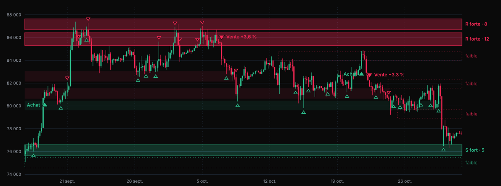

# AXIS S/R — zones classées par force et signal précoce sur zone forte

Date : 2026-11-09 · Origine : demande du propriétaire (« améliorer les signaux d'AXIS », précisée
ainsi : « j'aimerais les voir apparaître suffisamment tôt, que je puisse voir quelle zone marque
une forte résistance ou support »).

Référence visuelle approuvée par le propriétaire (« C est parfait »), dans la version qu'il a
retenue ensuite pour la profondeur d'historique (3 000 bougies, étiquettes abrégées) :
[`assets/2026-11-09-axis-sr-vue-c.svg`](assets/2026-11-09-axis-sr-vue-c.svg) — BTCUSDT 4h réel,
du 16 septembre au 31 octobre 2026, calculé avec le code actuel de `stratAxisSr` et un brouillon
jetable de la règle décrite au §4.5.

Invariants : aucune dépendance ; TypeScript strict (`noUncheckedIndexedAccess`) ; commentaires,
textes et documents en français ; **aucune fenêtre, aucun indicateur nouveau, aucun fournisseur,
aucun hôte** ; `stratAxis` (AXIS sans zones) inchangé ; signaux confirmés d'AXIS S/R inchangés au
caractère près ; aucune donnée haute fréquence dans le state React.

---

## 1. Intention

### 1.1 Ce que le propriétaire veut

Lire sur le graphe, d'un coup d'œil et assez tôt :

1. **quelles zones sont de forts supports ou de fortes résistances** ;
2. **le moment où le prix réagit sur l'une d'elles**, sans attendre le signal confirmé d'AXIS.

Il veut d'abord **voir**. Il ne demande pas une nouvelle campagne de variantes : celle du
1er novembre (AXIS v6) a rendu 10 verdicts défavorables sur 10 et a consommé le dernier lot
d'actifs jamais vus.

### 1.2 Ce qui ne va pas aujourd'hui (constaté dans le code)

- AXIS S/R trace les **zones les plus proches du cours**, pas les plus fortes : deux de chaque
  côté par défaut (`zonesSrAxis`, tri par proximité, `maxZonesSr` = 4). Sur la période de la
  maquette, les deux résistances les plus touchées (12 et 8 touches, entre 85 300 et 87 650)
  ne sont pas tracées.
- La force d'une zone (`touches + rejetsVolume + 0,5 si inversée`) ne règle que l'opacité du
  ruban, plafonnée à 4 : une zone à 12 touches se dessine comme une zone à 4.
- Le signal confirmé arrive tard par construction : 5 votes sur 6 d'indicateurs retardés, plus
  la clôture au-dessus de l'EMA 200.
- Une option de signaux précoces existe (`detecterRetournements`, décochée par défaut). Elle
  ignore les zones et n'a jamais été mesurée.

### 1.3 Ce que ce lot est, et ce qu'il n'est pas

C'est une **aide à la lecture**. Ce n'est pas un signal validé. Une mesure rapide (§9) ne trouve
aucun avantage aux signaux précoces sur BTC ; l'outil doit le dire (« non mesuré ») et ne
jamais présenter ces triangles comme une entrée prouvée.

---

## 2. Buts, non-buts, anti-buts

**Buts**

- B1. Dans AXIS S/R, les zones sont classées par force : fortes pleines, encadrées et
  étiquetées ; faibles en pointillé ; fortes désactivées estompées.
- B2. Un triangle creux marque la bougie qui réagit sur une zone forte.
- B3. Une alerte peut se déclencher sur cette réaction, avec le type d'alerte existant.
- B4. Chaque signal précoce porte la mention « non mesuré ».

**Non-buts**

- Prouver que les signaux précoces ont un avantage (aucune campagne, aucun test figé).
- Enrichir la force d'une zone avec d'autres sources : profil de volume, unité de temps
  supérieure, liquidations, options. C'est la suite envisagée, pas ce lot.
- Signaux intrabougie (avant la clôture).
- Toucher à `detecterRetournements`, à la couche flux, au garde-fou de régime, aux textes par
  unité de temps.
- Livrer un preset de backtest, ou ajouter les deux nouvelles sorties au catalogue d'opérandes
  de la fenêtre BT (`store/backtest.ts`).
- Modifier le panneau des alertes ou le texte de leurs notifications.
- Élargir la marge droite du graphe.

**Anti-buts** (le lot serait un échec même s'il « marche »)

- Un signal confirmé, ou l'une des séries `etat`, `score`, `prixSignal`, `stop`, `support`,
  `resistance`, qui change aux réglages existants : la validation d'AXIS en 4h repose dessus.
- Un triangle creux ou une bande qui apparaît, disparaît ou se déplace après coup (repaint).
- Un chiffre de la mesure rapide du §9 affiché dans l'interface, ou un texte qui suggère une
  entrée validée.
- Des étiquettes qui masquent les bougies récentes, ou un graphe ralenti sur 1 500 bougies.
- Un budget d'entrée dépassé.

---

## 3. Ce que le propriétaire verra

Tout se passe dans **AXIS S/R** (`stratAxisSr`). **AXIS** (`stratAxis`) ne change pas.

### 3.1 Zones

| Zone | Tracé | Étiquette au bord droit |
| --- | --- | --- |
| Forte, active | bande pleine, d'autant plus opaque qu'elle est forte, bord haut et bord bas en trait plein | « S fort · 5 » / « R forte · 12 » (rôle, puis nombre de touches) |
| Faible, active | pas de remplissage, bords en pointillé | « faible » |
| Forte, désactivée | bande pleine très estompée, qui s'arrête là où la zone a cessé d'être active | aucune |
| Faible, désactivée | non tracée | — |

Vert (`--up`) pour un support, rouge (`--down`) pour une résistance. La ligne médiane pointillée
actuelle disparaît : les bords la remplacent.

Les étiquettes sont abrégées pour tenir dans la marge droite existante du graphe (80 px, défaut
de klinecharts), sur bureau comme sur téléphone. La vue C approuvée les écrivait en toutes
lettres dans une marge de 190 px qui n'existe pas dans l'outil ; le libellé complet figure dans
l'infobulle de la zone.

### 3.2 Signal précoce

Un **triangle creux**, plus petit que le triangle plein des signaux confirmés : vert sous le plus
bas de la bougie pour une réaction sur support, rouge au-dessus du plus haut pour une réaction
sur résistance. Pas d'étiquette. Quand le réticule passe à 3 bougies ou moins du triangle,
l'infobulle du graphe décrit la zone et dit « non mesuré » (il n'y a pas de survol du triangle
lui-même pour une définition tracée sur le prix).

### 3.3 Ce qui ne change pas

Les ▲/▼ pleins, leurs étiquettes et leurs infobulles ; les triangles d'accent des forts achats
et fortes ventes ; l'option « Détecter les retournements » ; le filtre `margeResistanceAtr` ; les
séries masquées `support` et `resistance` (zone active la plus proche, quelle que soit sa
force) ; le preset BT « AXIS S/R confluence (4h) ».

### 3.4 Réglages (AXIS S/R seulement)

| Clé | Libellé | Type | Défaut | Bornes |
| --- | --- | --- | --- | --- |
| `forceZoneForte` (nouvelle) | Force d'une zone forte (touches + rejets sur volume fort) | nombre | 6 | 2 – 50 |
| `signauxPrecoces` (nouvelle) | Signaux précoces sur zone forte (non mesurés) | booléen | vrai | — |
| `maxZonesSr` (existante, sens précisé) | Zones faibles tracées (0 = aucune zone) | nombre | 4 | 0 – 12 |

AXIS S/R passe de 21 à 23 réglages. Une instance déjà posée sur un graphe reçoit les défauts des
deux nouvelles clés : les triangles creux y apparaissent à la mise à jour, c'est voulu.

### 3.5 Alertes

Deux sorties masquées nouvelles, sélectionnables dans une alerte de seuil d'indicateur
existante (`indicateur-seuil`), comme `etat` et `score` :

- `reactionSupport` — nom de sortie « Réaction sur support fort » ;
- `reactionResistance` — nom de sortie « Réaction sur résistance forte ».

AXIS S/R passe de 6 à 8 sorties (6 masquées). Aucun type d'alerte nouveau.

Le mécanisme existant est pris tel quel, avec ses limites, qui valent déjà pour `etat` et
`score` :

- le formulaire d'alerte liste les sorties par leur clé (`reactionSupport`,
  `reactionResistance`) ;
- une alerte est évaluée avec les réglages par défaut de l'indicateur (`forceZoneForte` = 6),
  même si l'instance du graphe en utilise d'autres ;
- elle ne se déclenche que l'application ouverte sur ce symbole et cette unité de temps : le
  daemon n'évalue que les alertes à 1 minute ;
- la notification garde sa formule générique (« stratAxisSr(reactionSupport) >= 1 ») ; la
  mention « non mesuré » vit sur le graphe et dans la documentation.

### 3.6 Profondeur d'historique : 3 000 bougies (décision du propriétaire)

Une zone compte ses touches depuis la première bougie chargée. La vue C a été calculée sur
3 000 bougies ; le graphe n'en charge que 1 500 quand AXIS est actif, et le résultat diffère
(à 1 500, la résistance à 12 touches des 85 300–86 400 n'existe pas, et 18 triangles creux
seulement sur 25 sont communs avec la vue C). Le propriétaire a vu les deux et a choisi
**3 000**.

- `stratAxisSr` déclare une amorce de **3 000 bougies** (`amorceBougies`) ; `stratAxis` reste à
  1 500 (`AMORCE_AXIS`).
- Le graphe remonte alors de lui-même à 3 000 bougies : cinq pages de 500 après le chargement
  initial, au lieu de deux (`amorceMinimale`, plafond `MAX_PAGES_SESSION` = 8, suffisant).
- La série de référence du garde-fou de régime (`refClose`, aujourd'hui 1 500 bougies en deux
  appels, `REFCLOSE_LIMIT` dans `chart/auxProvider.ts`) couvre la même profondeur. Sinon le
  garde-fou ne s'applique pas à la moitié ancienne et les signaux confirmés y redeviennent ceux
  de la v2.
- Source plus courte : tout ce qu'elle a. La mention « amorce courte » des signaux garde son
  seuil de 1 500.
- L'infobulle d'une zone dit sur combien de bougies ses touches sont comptées.

---

## 4. Définitions exactes

### 4.1 Moteur de zones (existant, inchangé)

`zonesSrAxis` garde ses règles : pivot de swing confirmé à `p + pivotSr` ; demi-largeur
`zoneSrAtr × ATR 14` ; fusion d'un pivot dans une zone active qu'il chevauche ; `rejetsVolume`
pour un pivot à volume relatif ≥ `seuilRvol` ; première cassure franche d'une zone renforcée
= inversion de polarité ; cassure d'une zone simple ou déjà inversée = désactivation ; vivier
plafonné à 24 zones actives, la plus ancienne sortant en premier.

`force = touches + rejetsVolume + (inversions > 0 ? 0,5 : 0)` — inchangée.

Le **rôle** d'une zone se lit par position, comme aujourd'hui : support si son niveau central
est ≤ au close de référence, résistance sinon.

### 4.2 Forte, faible, désactivée

- **Forte** : `force ≥ forceZoneForte` à la bougie considérée. Tant qu'une zone est active sa
  force ne décroît jamais ; une zone devenue forte le reste jusqu'à sa désactivation.
- **Faible** : active et non forte.
- **Désactivée** : sortie du vivier, par cassure ou par le plafond de 24. Une zone forte franchie
  une première fois change de rôle et reste active ; c'est sa seconde cassure qui la désactive.

### 4.3 Zones tracées (état à la dernière bougie décidée, `fin`)

1. **Toutes** les zones fortes actives.
2. Parmi les zones faibles actives, les `maxZonesSr` plus proches du close de `fin`, avec le
   partage actuel : moitié supports, moitié résistances, complété par les plus proches restantes.
3. Les **12 zones fortes désactivées les plus récentes** : fortes à leur dernière bougie active,
   c'est-à-dire à la clôture de la bougie qui précède leur désactivation (décision du
   10 novembre 2026 : une zone faible pendant toute sa vie visible n'est pas tracée en
   « forte cassée » parce qu'une fusion de la bougie qui la casse l'a renforcée).
4. `maxZonesSr` = 0 : aucune zone tracée, ni forte, ni faible, ni désactivée. Les signaux
   précoces, eux, suivent leur propre réglage.

### 4.4 Bande d'une zone

- Elle commence à la bougie de **confirmation** de la zone (`confirmationIdx`), plus à son pivot
  d'origine : avant cette bougie, le graphe ne connaissait pas la zone.
- À chaque bougie, ses bornes sont celles **connues à la clôture de cette bougie**. Une zone qui
  fusionne un nouveau pivot voit donc sa bande se déplacer à partir de ce moment, pas avant.
  (`RubanAnnotation` porte déjà une borne haute et une borne basse par bougie.)
- Zone active : jusqu'au bord droit ; les bougies après `fin` reprennent la dernière valeur.
- Zone désactivée : jusqu'à la dernière bougie où elle était active ; la bougie qui la casse
  n'est pas couverte.
- Une seule couleur par bande : le rôle à `fin` pour une zone active, le rôle à sa dernière
  bougie active pour une zone désactivée.
- Opacité d'une zone forte active, à titre indicatif (maquette) :
  `min(0,34 ; 0,14 + 0,012 × min(16 ; force))`. Zone forte désactivée : environ 0,09.

### 4.5 Réaction sur zone forte

Décidée **à la clôture** de la bougie `i` (`i ≤ fin`), avec les zones telles qu'elles étaient
**après la bougie `i − 1`** : zones actives, bornes, force. Rien de ce que la bougie `i` apprend
sur les zones (pivot confirmé en `i`, cassure en `i`) n'entre dans la décision.

Pour chaque zone forte `z` de cet état, avec `amplitude = high[i] − low[i] > 0` et
`position = (close[i] − low[i]) / amplitude` :

| Rôle de `z` (niveau ≤ `close[i − 1]` → support) | Évènement de réaction si |
| --- | --- |
| Support | `low[i] ≤ z.haut` **et** `close[i] > z.haut` **et** `position ≥ 0,5` |
| Résistance | `high[i] ≥ z.bas` **et** `close[i] < z.bas` **et** `position ≤ 0,5` |

- **Réarmement par zone** : une même zone ne produit pas d'évènement à moins de 4 bougies du
  précédent (`i − dernier ≥ 4`).
- **Marqueur** : au plus un triangle creux par bougie et par sens. Si plusieurs zones réagissent
  dans le même sens, l'infobulle cite la plus forte, puis la plus proche du close.
- **Bougie de signal confirmé** : le triangle creux n'y est pas tracé (le triangle plein
  suffit) ; les sorties du §4.6 restent renseignées.
- Les 120 marqueurs les plus récents sont tracés, comme pour les signaux confirmés.
- `signauxPrecoces` = faux : aucun triangle creux. Les sorties du §4.6 restent calculées.

### 4.6 Sorties `reactionSupport` et `reactionResistance`

Pour `i ≤ fin` : 1 si la bougie porte au moins un évènement de ce sens, 0 sinon. Pour `i > fin`
(bougie en formation) : indéfini. Elles ne dépendent ni de `signauxPrecoces` ni de `maxZonesSr`.

### 4.7 Textes de survol

- Triangle creux : sens (support ou résistance), bornes de la zone, touches, rejets sur volume
  fort, inversion éventuelle, ce que la bougie a fait (entrée dans la zone, clôture au-dessus
  ou au-dessous), puis la réserve **« signal précoce non mesuré — lecture indicative, jamais
  une promesse »**. Aucun chiffre de performance.
- Zone : le texte actuel (bornes, niveau, écart au cours, touches, rejets, inversion), précédé
  de « forte » ou « faible ».
- L'infobulle du pane n'affiche que **3 lignes** (`chart/indicators.ts`, `createTooltipDataSource`),
  prises dans cet ordre : segments dont l'arrivée est à 3 bougies ou moins du réticule,
  marqueurs à 3 bougies ou moins, puis rubans couvrant la bougie, chacun dans l'ordre de son
  tableau. En conséquence :
  - les bords de zone, s'ils sont des segments, ne portent **pas** d'info ;
  - les triangles creux sont rangés après les signaux confirmés et **avant** les forts
    mouvements, pour ne pas être évincés ;
  - les zones fortes les plus proches du cours viennent en tête des rubans ; les zones faibles
    suivent ; les zones désactivées ne portent pas d'info.

---

## 5. Contraintes

- **Causalité.** Évènements de réaction, sorties du §4.6 et bornes des bandes jusqu'à une bougie
  `T` : identiques qu'on calcule sur la série entière ou sur son préfixe arrêté à `T`, et
  insensibles à un futur altéré. Le choix des zones tracées (§4.3) dépend de `fin` par nature.
- **Une seule passe.** Le calcul tourne à chaque mise à jour sur 1 500 bougies et plus : pas de
  relance du moteur de zones par bougie. La maquette le faisait ; ce n'est admis que comme
  oracle de test (§6).
- **Types.** `@axiom/types` est figé par le contrat. Ce lot autorise des ajouts **optionnels
  seulement**, dont l'absence redonne le rendu actuel : un marqueur creux et, si nécessaire, un
  ancrage d'étiquette au bord droit. Les deux moteurs de rendu (`chart/annotationsPane.ts`
  pour les définitions en overlay, `chart/annotationsPrix.ts` pour les panes séparés) acceptent
  ces champs ; aucun autre indicateur ne change d'aspect.
- **Couleurs.** Jetons du thème (`--up`, `--down`), jamais d'hexadécimal hors des replis nommés
  (garde-fou `lib/gardeFous.test.ts`).
- **Budget d'entrée**, bloquant : 1 220 000 octets bruts et 360 000 gzip
  (`scripts/verifier-budget-build.mjs`). Mesure de départ sur cette branche, le 9 novembre :
  **1 188 293 / 354 533**, marge gzip 5 467. Sous 3 000 de marge après le lot, libérer des
  octets avant de livrer.
- **Profondeur d'historique, limite connue et acceptée.** Zones et triangles creux dépendent de
  la première bougie chargée : remonter assez loin dans le passé pour charger plus d'historique
  les redessine, comme les zones d'AXIS S/R aujourd'hui. Ce n'est pas le « repaint » des
  anti-buts, qui vise les bougies futures. Les alertes lisent le tampon du graphe : elles ne
  voient 3 000 bougies que si AXIS S/R y est affiché.
- **Coût du calcul.** Un calcul complet d'AXIS S/R prend aujourd'hui 1,3 ms à 1 500 bougies et
  2,9 ms à 3 000 (médiane de 30 calculs, Bun, poste du propriétaire). Après le lot, il reste
  sous 10 ms à 3 000 bougies ; la mesure avant/après figure au rapport.
- **Téléphone.** Les étiquettes abrégées restent lisibles à 390 px de large.
- **Branche.** `feat/axis-sr-zones-fortes` (worktree `.worktrees/axis-sr-zones-fortes`), partie
  de `main` `a2043a1`. La branche `feat/axis-toutes-unites` (v6) reste non fusionnée et touche
  `stratAxis.ts` : ne pas la fusionner, ne pas en reprendre le code.
- **Procédé** (`.devin/provider-rules.md`) : lots à fichiers attribués, tests écrits avec le
  code, revue indépendante de chaque lot (calcul financier), `pnpm check` et `pnpm check:e2e`
  verts. Fusion, poussée et déploiement : sur accord explicite du propriétaire.
- **Documents**, rédigés par l'orchestrateur en fin de chantier : section datée dans
  `BUILD-CONTRACT.md`, section AXIS S/R de `docs/axis-2026-10-07.md`, paragraphe du `README.md`.

---

## 6. Vérification attendue

1. **Oracle naïf.** Un test compare l'implémentation en une passe à une référence lente écrite
   dans le test : pour chaque bougie `i`, zones = `zonesSrAxis(…, maxZonesSr ≥ 24, fin = i − 1)`,
   puis règle du §4.5 appliquée telle quelle. Mêmes évènements : sur les 1 200 dernières
   bougies du cas de référence du point 4 (la référence lente y prend une demi-seconde ; près
   de six sur les 3 000, d'où la tranche), sur la fixture dorée existante
   (300 bougies : abaisser `forceZoneForte` à 2 si le seuil 6 n'y produit rien) et sur une série
   synthétique qui produit au moins une réaction sur support fort, une sur résistance forte, un
   réarmement refusé puis accepté, une inversion, une désactivation.
2. **Identité.** Aux réglages existants, `etat`, `score`, `prixSignal`, `stop`, `support`,
   `resistance`, marqueurs et étiquettes des signaux confirmés et des forts mouvements :
   identiques à ceux d'avant le lot. Les tests de `stratAxis` passent sans être modifiés.
3. **Causalité.** Préfixes et futur altéré, sur les évènements, les deux sorties et les bandes.
4. **Cas de référence, en test commité.** 3 000 bougies BTCUSDT 4h de Binance Spot, de
   l'ouverture du 2025-06-19T00:00Z à celle du 2026-10-31T20:00Z, versées dans
   `packages/indicators/src/strategy/fixtures/btcusdt-4h-3000.json` (SHA-256
   `3db483de16113c976b95d1141f91828f32c8b5bcbe31e35aa631b227a73f42f2` ; colonnes `time`, `open`,
   `high`, `low`, `close`, `volume`, `buyVolume` ; `sellVolume = volume − buyVolume` ; toutes les
   bougies `closed: true`, donc `fin` = 2 999). Réglages par défaut, `refClose` = les closes de
   la série (convention du test ; dans l'application, la référence d'un graphe BTC est ETHUSDT). Le constructeur peut déplacer le fichier, pas le
   modifier. Les évènements se comptent par zone ; ici le compte par (bougie, sens) est le même.
   - 8 zones fortes actives à la dernière bougie, dont
     résistance [85 314,76 – 86 430,38] 12 touches, 7 rejets, inversée ;
     résistance [86 702,87 – 87 649,68] 8 touches, 4 rejets, inversée ;
     support [75 626,55 – 76 601,83] 5 touches, 2 rejets ;
   - 122 évènements de réaction depuis la première bougie (62 sur support, 60 sur résistance,
     le premier à l'index 250), dont 115 depuis l'index 400 (59 et 56) et 31 depuis l'index
     2 728 (2026-09-16T16:00Z) ; aucune bougie ne porte les deux sens ; un seul évènement tombe
     sur une bougie de signal confirmé (2 850) ;
   - 27 zones fortes désactivées sur la période, dont les 12 plus récentes restent tracées ;
   - premiers évènements depuis l'index 2 728 : 2 733 support, 2 750 support, 2 754 résistance,
     2 761 résistance, 2 766 support ;
   - signaux confirmés depuis l'index 2 728 : achat 2 740, vente 2 850, achat 2 937, vente 2 942.
   Ces bougies ont déjà été lues par les campagnes (v2, v6) : aucune donnée nouvelle n'est
   consommée, la frontière du 2026-11-01T00:00Z ne bouge pas.
5. **Preuves visuelles.** Captures du graphe réel BTCUSDT 4h avec AXIS S/R, bureau et
   téléphone, comparées à la vue C.
6. **Profondeur.** Un test montre que l'amorce exigée par le graphe est de 3 000 bougies quand
   AXIS S/R est actif et reste de 1 500 pour AXIS seul, et que `refClose` est demandée sur la
   même profondeur.
7. `pnpm check` et `pnpm check:e2e` verts ; budget d'entrée et coût du calcul mesurés avant et
   après.

---

## 7. Laissé au constructeur

- La structure interne : suivi des zones en une passe, forme du résultat étendu de
  `zonesSrAxis`, découpage des fonctions.
- La mécanique des étiquettes au bord droit (ancrage, écartement vertical quand deux zones sont
  proches), tant qu'elles tiennent dans la marge de 80 px et ne masquent pas les bougies récentes.
- La taille exacte du triangle creux et la courbe d'opacité.
- La rédaction des infobulles, dans les limites du §4.7.
- Le détail des tests au-delà du §6, et la preuve qu'une alerte de seuil se déclenche sur une
  bougie de réaction.
- La mise à jour des tests existants que le nouveau tracé rend caducs (rubans et segments de la
  « fixture dorée », compte des réglages et des sorties).

---

## 8. Choix de l'orchestrateur, à vérifier par le propriétaire

Le propriétaire a approuvé la vue C, puis la description qui en a été faite le 9 novembre. Les points
suivants précisent ce qu'il n'a pas tranché lui-même :

1. Une bande commence à la confirmation de la zone et montre ses bornes telles qu'elles étaient
   connues à chaque bougie (aujourd'hui : depuis le pivot d'origine, bornes finales).
2. Au plus un triangle creux par bougie et par sens ; aucun sur une bougie de signal confirmé ;
   réarmement d'une zone après 4 bougies.
3. Les 12 zones fortes désactivées les plus récentes restent tracées, estompées.
4. `maxZonesSr` compte désormais les zones faibles ; 0 masque toutes les zones.
5. Deux sorties masquées pour les alertes, calculées même quand les triangles sont masqués.
6. Au plus 120 triangles creux tracés.
7. Deux champs optionnels ajoutés à `@axiom/types` (marqueur creux, ancrage d'étiquette).
8. La ligne médiane pointillée des zones disparaît.
9. Étiquettes abrégées (« R forte · 12 ») pour tenir dans la marge droite existante ; le
   propriétaire les a vues sur l'écran de choix de la profondeur.
10. Les alertes prennent le mécanisme existant avec ses limites (§3.5) ; les deux sorties ne
    sont pas ajoutées aux opérandes de la fenêtre BT.
11. Le cas de référence BTC est versé au dépôt comme fixture de test (232 Ko).
12. La dépendance des zones à la profondeur chargée est acceptée comme limite connue (§5) ;
    l'infobulle d'une zone dit sur combien de bougies elle est comptée.

---

## 9. Mesure rapide (contexte, hors protocole)

BTCUSDT 4h, de fin août 2025 à fin octobre 2026 (2 600 bougies), données déjà lues, un seul
actif, aucune règle figée à l'avance. Rendement signé de l'open suivant à l'open 6 bougies plus
loin. Le prix a dérivé de −0,06 % en moyenne sur 6 bougies.

| Signal précoce | Nombre | Moyenne à 6 bougies | Dans le bon sens |
| --- | ---: | ---: | ---: |
| Option existante, retournement « achat » | 177 | +0,01 % | 51 % |
| Option existante, retournement « vente » | 175 | +0,21 % | 56 % |
| Réaction sur support fort (§4.5) | 59 | −0,39 % | 46 % |
| Réaction sur résistance forte (§4.5) | 56 | −0,19 % | 45 % |

Sur la même durée : 16 achats et 16 ventes confirmés. Les retournements de l'option existante
devancent le signal confirmé de 2 à 3 jours en médiane et sont onze fois plus nombreux que lui ;
les réactions sur zone forte, près de quatre fois. Croiser les retournements avec les zones
n'améliore rien.

Ces chiffres décrivent le passé d'un actif. Ils ne valident ni n'invalident rien, et ne
paraissent nulle part dans l'interface. Les scripts de la maquette étaient jetables et ne sont
pas dans le dépôt.

**Suite envisagée, hors de ce lot** : chercher une définition de la force qui tienne (autres
sources du §2), et la juger sur les bougies à venir, seul terrain jamais vu qui reste.
